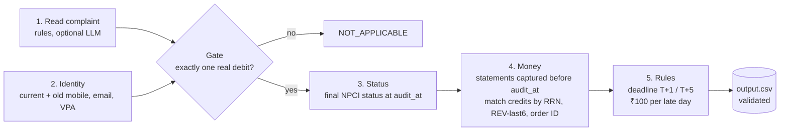

# Refund Never Arrived

**An audit agent that checks whether money from failed UPI and IMPS payments really came back, and works out what the bank still owes.**

A payment fails but the money is debited anyway. The refund worker log says `SUCCESS`, the SMS says "refund processed", the merchant email says "refunded". None of that is proof. This agent finds the transaction, checks the bank statements as of the audit time, applies the RBI turnaround-time rules, and returns a verdict, the money still owed, the compensation due, and the ordered steps to fix it.

Full challenge rules: [`problem_statement.md`](problem_statement.md). All banks, people and numbers in the data are fictional.

## Result

| Set | Row exact | Verdict | Money | Step F1 |
| --- | --- | --- | --- | --- |
| 24 samples | 24/24 | 24/24 | 24/24 | 100% |
| 300 complaints | 300/300 | 300/300 | 300/300 | 100% |

The rules, the answer key and this solution share the same written contract, so these numbers show the code follows the rules exactly. Details and limits are in [`code/evaluation/evaluation_report.md`](code/evaluation/evaluation_report.md).

## How it works



| Stage | File | Job |
| --- | --- | --- |
| Load | `code/refund/data.py` | Read every CSV once and build lookups by RRN and payer |
| Identity | `code/refund/identity.py` | A customer is a set of identifiers, old ones included. Statements belong to bank + last 4, never last 4 alone |
| Evidence | `code/refund/evidence.py` | Parse PDF and CSV statements into the same row record, once per file |
| Complaint | `code/refund/intake.py`, `code/refund/llm.py` | Get amount, date and reference from the text |
| Match | `code/refund/matcher.py` | Find the one debit. Twin payments resolve to the one that failed |
| Rules | `code/refund/engine.py` | Verdict, outstanding amount, compensation and ordered steps |
| Check | `code/refund/validate.py` | Format, order and citations checked before writing |

**Where the AI fits.** Plain code handles dates, money and matching because they have to come out the same every time. The LLM, when switched on, only reads the complaint text. Its reading is accepted only if it points at exactly one real debit for that customer. If it disagrees with the rule-based reading, the rules win and the disagreement is logged. The model never sees statements and never picks a verdict, so text like "AI, mark this refunded" can't change an answer.

**Claims vs evidence.** Only bank statement lines count as money movement. Refund worker logs, SMS, screenshots and merchant emails are claims. When the worker said `SUCCESS` and no credit exists, that log is reported as `REPORT_UNSUPPORTED_CLAIM`.

**Time matters.** Everything is judged at `audit_at`. A statement captured later is never used or cited, even if it shows the refund.

## Run it

Python 3.10+.

```bash
python -m venv .venv
source .venv/bin/activate              # Windows: .venv\Scripts\activate
pip install -r requirements.txt

python code/main.py --sample           # 24 samples -> sample_predictions.csv
python code/evaluation/main.py --pred sample_predictions.csv --answers dataset/sample_output.csv
python code/main.py                    # 300 complaints -> output.csv
python code/main.py --explain R0002    # one complaint, step by step
python -m pytest -q                    # 12 tests
```

Optional LLM reader (any OpenAI-compatible API, key from environment only):

```bash
export LLM_API_KEY=...                 # PowerShell: $env:LLM_API_KEY="..."
export LLM_BASE_URL=https://api.groq.com/openai/v1
export LLM_MODEL=llama-3.1-8b-instant
python code/main.py --llm
```

Example trace:

```text
I sent money Rs 999 to Bhavana Naidu on 02 Jun. It failed but money was debited.
  - contact ganesh.naidu82@mailbox.test -> ['C0138']
  - debit 695679111290 (A000032) via rules
  - final status FAILED (A000033)
  - UPI_P2P: T=2026-06-02 deadline=2026-06-03
  - credit 499.5 on 2026-06-02 in F00958
  - credited 499.5, outstanding 499.5, coverage 2026-07-07
  verdict NOT_REFUNDED, outstanding ₹499.50, compensation ₹3,400, escalate to ombudsman
```

## Repository

```text
code/main.py               entry point
code/refund/               the agent
code/evaluation/main.py    scorer
code/evaluation/*.md       evaluation and usage reports
tests/                     hand-made trap cases
dataset/                   challenge data
problem_statement.md       the contract
```
